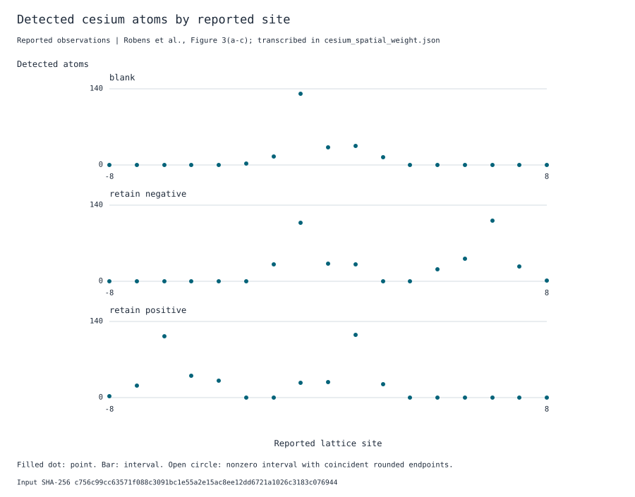
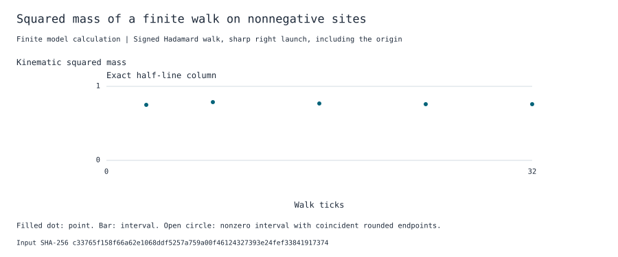

# Exact point and interval plots

Science and Mathematics workers can give the Rust host one strict JSON plot. Each row supplies an x coordinate and the lower and upper endpoints of a y interval. A point repeats its y coordinate. Each series has its own panel with the same two axes, so points in different series can share coordinates. The renderer draws every row, including zeros and isolated extremes. It does not join samples or infer a confidence interval.



The [Science input](cesium_counts.json) includes all 51 transcribed site counts in Figure 3(a–c), including zeros. These are detected atoms. The supplied source does not give an incident count for every panel. [Research archive](https://github.com/KirtusJ/From-Prephysical-Hypotheses-to-Physical-Models/blob/344e23365aa214507c9b188e2fe7b53f2807dd66/Director_G/results/cesium_spatial_weight.json)



The [Mathematics input](finite_walk.json) gives every half-line position entry from the registered finite walk comparison. They are model squared masses. A physical probability interpretation needs a detector experiment. [Research archive](https://github.com/KirtusJ/From-Prephysical-Hypotheses-to-Physical-Models/blob/344e23365aa214507c9b188e2fe7b53f2807dd66/Director_G/results/compact_position_reference.json)

## Inputs and projection

Supply exactly `title`, `source`, `provenance`, `x_label`, `y_label`, `x_domain`, `y_domain`, and `series`. Each domain is a strictly increasing pair. Each of 1–4 distinctly named series contains exactly `name` and `data`, where data contains 1–64 triples `[x,lower,upper]`. Coordinates can be signed JSON integers in the host's 64-bit range or strings of decimal integers or integer fractions. Strings allow up to 256 digits per component and require a positive denominator. Labels use printable ASCII and single interior spaces. The limit is 54 characters for the title, 88 for source, 38 per axis label and 48 per series name. Axis endpoint labels fit 16 characters after fraction reduction. The full canonical input and the CLI input stream each have a 128 KiB limit.

`provenance` is `model`, `observed`, or `mathematics`. This is the supplier's classification. `source` names the source and is displayed literally. Preserve any observation denominator and scope in the source data. Different kinds of evidence need separate figures.

Coordinates are compared and projected through signed arbitrary-precision integer arithmetic. The nearest pixel represents each coordinate, with ties toward the larger mathematical coordinate. All x positions in a series must increase and map to different pixels. A reversed interval, an out-of-domain coordinate, an input too long, or an unreadable value refuses the whole plot. An interval whose endpoints round to the same pixel receives an open circle. A filled dot denotes exact equality. Small intervals and observations occupy finite marker width on screen. Read the retained JSON for exact values. An input SHA-256 printed on the plot binds even distinctions hidden by pixel resolution. The value hashes the host's canonical JSON, including the supplied rational spelling.

## Use from a terminal or worker

In a shell with byte-preserving redirection, after building the host, run:

```sh
pcpos plot < finite_walk.json > output.svg
```

In Windows PowerShell versions that transcode native output, use this cross-platform byte-preserving form in the examples directory:

```sh
python -c "import pathlib,subprocess; p=pathlib.Path; p('output.svg').write_bytes(subprocess.check_output(['pcpos','plot'],input=p('finite_walk.json').read_bytes()))"
```

The CLI accepts no output path. The caller chooses whether to save the graphic. In MCP, `acr_plot` takes `{"plot": ...}` and returns one UTF-8 SVG embedded resource with MIME type `image/svg+xml`. Its URI is `urn:sha256:<digest>` for the actual returned text bytes; it identifies the embedded artifact and has no external retrieval service. The call writes no register or files. At the CLI and via `acr_instrument`, the shared instrument `visualization.ranges` takes `{"plot": ..., "expected_svg_sha256": "..."}`. It renders the plot again and compares its SVG bytes with the supplied digest. A mismatch is a failed property (CLI exit 1); malformed input is refused (CLI exit 2). The receipt gives the SVG digest and byte count, canonical input digest, number of rows, and number of nonzero intervals whose projected endpoints coincide. A recorded check stores this receipt and the host’s ordinary bounded input preview. Keep the input JSON separately for replay.

The SVG renderer uses the Plotters backend and its drawing traits, both at 0.3.7 with default features disabled. It uses no image encoder, native font library, JavaScript, external URL, file or network service at render time. Browser font choices can affect text layout. `Cargo.lock` identifies all downloaded crates. A clean host needs the locked dependencies once (`cargo fetch --locked`) or a prepared Cargo cache. With those dependencies available, `cargo build --offline --locked --release --bin pcpos` builds the renderer. Plotting adds no dependency to the integrity core or bare-metal kernel. [Plotters SVG backend](https://docs.rs/plotters-svg/0.3.7/plotters_svg/struct.SVGBackend.html)
