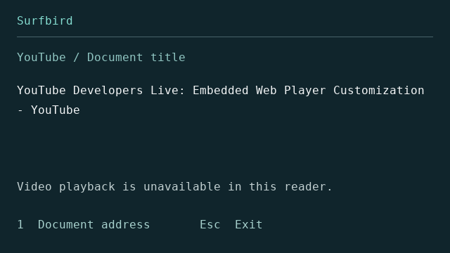

# Reading the public watch document

In the `document` arm, the native Surfbird ELF retrieves the public watch URL over its verified TLS connection. It reads the HTML head until it has found the canonical link and the document title. The guest paints the title in the framebuffer. Press **1** for the canonical address, **B** to return and **Esc** to exit. Both screens use metadata from the same received document. Opening the address view reads the saved field locally. [Requested document](https://www.youtube.com/watch?v=M7lc1UVf-VE) · [WHATWG document title](https://html.spec.whatwg.org/multipage/semantics.html#the-title-element)



The observed title was “YouTube Developers Live: Embedded Web Player Customization - YouTube”. The guest received an HTTP 200 and consumed 785,783 decoded body bytes through the TLS record containing the title. QEMU observed 819,565 incoming TCP payload bytes including retransmissions. The [address screen](evidence/watch-document/address.png) preserves the case of the video identifier. The kernel recorded three presented frames, a clean exit and zero milliseconds of sound. These are document-reader frames. [Receipts](evidence/watch-document/results.json)

## Replay

Build the existing `https-probe` ELF and use the same Ethernet-enabled kernel, RTC, trust store and CPU configuration as the [HTTPS probe](HTTPS.md). Its prior prefix-only and certificate-control modes remain available.

```sh
python3 replay_https.py "$kernel" "$guest" run-document --arm document
```

The harness boots an isolated QEMU instance and records its encrypted Ethernet traffic, guest serial and PPM framebuffer dumps. It drives the three keys through the emulated keyboard. A separate Python verifier checks the actual title and address glyphs pixel by pixel against the kernel typeface. It also requires the complete Back screen to equal the first screen. The title comes from the guest serial without supplying an expected video name. A replay opens one public connection. Server content, reachability and certificate chains can change.

## What the reader accepts

The guest checks the server name, certificate path, HTTP status, HTML content type, identity content encoding and framing. It decodes fixed-length, close-delimited or plain chunked body data across TLS records. It stops after a usable head prefix. The profile caps headers at 32 KiB, decoded body storage at 2 MiB, candidate scans at eight and the printable ASCII title at 144 bytes. The canonical link must precede the title and match the requested address exactly. Standard title entities for common punctuation and printable ASCII numeric references are decoded. [HTTP/1.1 framing](https://www.rfc-editor.org/rfc/rfc9112.html#section-6) · [Reader and tests](src/watch_document.rs)

The restricted grammar recognizes explicit HTML and head elements, links, metadata, comments and ordinary script/style raw text. It skips inline code. Unsupported head structures, escaped script syntax, compression, chunk extensions and unsupported titles cause the read to fail. The guest requests one watch document and renders its verified metadata. The remaining document, subresources, DOM, scripts, media and player controls are outside this mode. A readable title alone establishes neither video availability nor playback.

## A route to native playback

Servo exposes a WebView, an event loop and a rendering context that can be software-backed. Its source declares separate JavaScript JIT and GStreamer media features. The guest kernel currently gives a static ELF a small Linux-style ABI, a framebuffer and capability-gated device handles. Its ABI lacks threads, pipes and sockets. The current single-request smoltcp client cannot serve as the platform backend for a running browser. [Servo embedding interface](https://doc.servo.org/servo/) · [Servo media and JavaScript features](https://github.com/servo/servo/blob/main/components/servo/Cargo.toml) · [Kernel syscall interface](../../../PCP_OS_Rust/crates/pcpos-kernel/src/sys.rs)

A concrete port test is to boot a guest-resident WebView with a software surface, load a local two-origin iframe and demonstrate a JavaScript `postMessage` round trip. That needs working engine task scheduling, memory management, resource loading, rendering and an event dispatcher. The next media check would render a rights-cleared local HTML video through that engine with decoded audio reaching the guest sound device. The existing [local A/V fixture](LOCAL_MEDIA.md) tests the output devices directly. Servo support for the official YouTube player on this guest remains unverified.

For a public playback test, load the official embedded player with client identification through the documented HTTP Referer or supported equivalent, the documented minimum viewport and an unobscured user playback control. Acceptance requires an actual player event with advancing media time, changing guest-rendered video and independently observed guest audio. Keep the engine's standard public player requests within that session. [YouTube IFrame API and requirements](https://developers.google.com/youtube/iframe_api_reference) · [YouTube embedded-player requirements](https://developers.google.com/youtube/terms/required-minimum-functionality)
