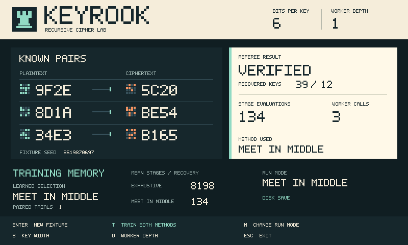

# Keyrook

Keyrook is a cryptography training application for PCP OS. A referee generates a synthetic cipher challenge. Workers see three plaintext/ciphertext pairs and can divide the key search among their children. The referee checks the proposed key against the one used to make the challenge. The learner keeps the measured cost and result of each strategy and uses them to choose how to attack a fresh fixture.

## Play a session



Launch the native application through the Store launcher from the repository root. Supply your built PCP OS kernel image.

```sh
cargo run --release --locked --manifest-path store/native/Cargo.toml -- path/to/pcpos-kernel.elf32 keyrook
```

Press Enter in the PCP OS menu. In Keyrook, **T** trains both attacks on the same fresh fixture. **Enter** challenges the selected strategy on the next fixture. **B** changes the number of bits in each key, **D** changes the recursion depth, **M** cycles through attack strategies and the learned choice, and **Esc** returns to the OS. The profile saves into the guest user store. On a stock RAM-backed kernel it lasts for that boot.

## What learns

The application offers two strategies. Exhaustive search tries every pair of stage keys. Meet-in-the-middle computes the first encryption under each possible first key, reverses the second encryption under each possible second key, and tests all collisions against the remaining public pairs. Collisions and failed or ambiguous recoveries count in the results. Each worker searches a half-open interval of second keys. Depth three makes eight leaves and fifteen calls. The built-in recursion executes locally in a deterministic order. External agents may run partitions concurrently.

The learner first explores both strategies and then selects the one with the lowest cumulative cipher-stage evaluations per verified recovery. This is selection between two programmed attacks. Work measures cipher-stage evaluations; sorting, memory, agent startup, elapsed time and model tokens are separate costs. The 4-, 6- and 8-bit settings vary the search space. The cipher uses two tiny keys, public synthetic fixtures and a deterministic seed for replay. [Candidate specification and first adversarial review](reviews/twin-rook-v1.md) · [MIT lecture on meet-in-the-middle](https://65610.csail.mit.edu/2023/lec/l06-encimpl.pdf)

## External workers

### Session storage

The hosted application keeps each session in its own directory using the embedded Rust database redb. Run `keyrook new my-session` to initialize one. Run `keyrook train my-session 8 0 2`, then repeat with seeds 42 and 31415. Use `keyrook stats my-session 8` after reopening the program. Use a fresh seed at each difficulty. To query a snapshot in SQLite, run `keyrook export-sqlite my-session trials.sqlite` with a new output filename. The native guest uses its own compact profile in the guest filesystem.

### Assigning work

Build both hosted binaries with `cargo build --release --locked --manifest-path store/apps/keyrook/host/Cargo.toml`. The examples assume they are on your path. Use `keyrook challenge 8 31415` to reproduce the public pairs. Give the worker just the bits and the pairs. The reproducibility seed stays with the referee.

```sh
keyrook-peer split 8 1 0 256 ee0e:6346 fc3a:8e9a 45c3:0338
keyrook-peer work 8 1 0 128 ee0e:6346 fc3a:8e9a 45c3:0338
keyrook-peer work 8 1 128 256 ee0e:6346 fc3a:8e9a 45c3:0338
keyrook solve 8 3 1 ee0e:6346 fc3a:8e9a 45c3:0338
```

Each split emits two child work orders. A child can split its own interval again. Each leaf returns JSON with its interval, candidate count, unique key when present, and work. A coordinator checks that the returned intervals cover its whole assignment exactly once, associates each response with the original challenge, and reruns the decisive search. A candidate can be verified against the pairs; the absence of other candidates requires coverage. Independent processes each pay for their own forward table.

For confidential exchanges, send the work order and receipt through the session's established encrypted channel. To authenticate an external worker, an operator can sign the exact receipt bytes with a dedicated OpenSSH key and verify them against a pinned allowed signers file. Use a distinct signature namespace such as `keyrook-receipt-v1` and include the assignment ID, challenge, interval and outcome inside the signed bytes. Encryption addresses a recipient. A verified signature identifies a signer. Neither establishes that the reported search ran. [OpenSSH signatures](https://man.openbsd.org/ssh-keygen#ALLOWED_SIGNERS) · [age format](https://age-encryption.org/v1)

Language-model and Qwen integration is tracked for a later release. The public work order and JSON leaf result are the current machine interface. A future adapter should document model selection, public inputs, context limits, encryption, measured cost and replay through the same referee. [PCP OS local Qwen example](../../../examples/qwen/)
