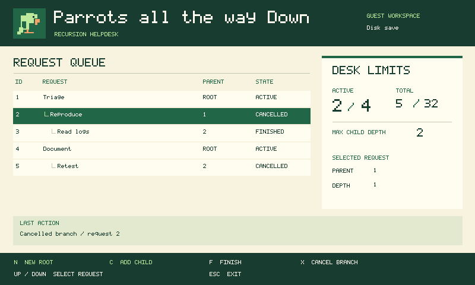

# Parrots all the way Down

Use this recursion help desk to see who delegated a job, admit a child within a budget, and close the branch when its work ends. A root is at depth zero. Every child has one parent. Depth limits how far a branch can grow, the live limit controls simultaneous work, and the lifetime limit counts every admission even after work finishes.



## Run the native desk

From the repository root, supply a stock PCP OS kernel built as described in the [launcher guide](../../native/README.md).

```sh
cargo run --locked --release --manifest-path store/native/Cargo.toml -- path/to/pcpos-kernel.elf32 parrots-all-the-way-down
```

Press Enter in the OS menu. **N** opens a root. **C** opens a child of the selected row. Type a label and press Enter to submit, or Escape to discard the edit. Use the arrow keys to select a request. **F** finishes it once its children close. **X** cancels its active subtree and keeps the history. Escape from the queue returns to the launcher.

The native profile permits depth 2, four live requests and 32 lifetime admissions. The screen reports whether its journal is saved for the boot session or written to disk. The stock launcher uses session storage. A disk-backed guest can restore the queue at the next boot from the same store. An unreadable journal locks the queue for recovery. See the [guest recovery guide](guest/README.md) before replacing a damaged save. These are desk records. A native queue entry by itself starts no process.

## Dispatch real workers

Install the hosted Rust commands from the repository root.

```sh
cargo install --locked --path store/apps/parrots-all-the-way-down/host
parrots-all-the-way-down init team.redb 2 4 32
pcp-delegate team.redb period-01 first-pass -- rustc --version
parrots-all-the-way-down status team.redb
```

Replace the last two arguments of the dispatch with a worker executable and its arguments. A cooperating worker launches its own child with `pcp-delegate - UNIQUE_REQUEST LABEL -- PROGRAM [ARG ...]`. The dash uses the inherited desk and parent. Point every worker that shares a budget at the same authority. For an LLM tool, have the trusted tool server invoke this command before it dispatches work. Granting a model independent launch tools puts those calls outside this budget.

Only a trusted supervisor should set the inherited authority and parent. Same-user programs can change their environment, open a different database, or invoke another launcher.

The adapter commits admission before spawning the process. A repeated request ID prevents a second launch. If the supervisor disappears between admission and exit, inspect the process and the retained node before closing it. Direct children are polled for cancellation. Operating system process groups, disconnected machines and processes started around the adapter require separate supervision.

## Maintain a queue from a terminal or program

```sh
parrots-all-the-way-down open team.redb review-01 root review
parrots-all-the-way-down status team.redb
```

Read the returned numeric node ID. Use `open FILE NEW_REQUEST PARENT_ID LABEL` for a child, `get FILE ID` for one row, `finish FILE NEW_REQUEST ID` for a completed leaf, and `cancel FILE NEW_REQUEST ID` for an entire active branch. Successful mutations print a JSON receipt with node, revision and replay status. Repeating the same request and arguments returns its original receipt. Reusing a request ID with different arguments fails. Store the database in a location readable and writable only by the intended operators. Labels are stored in clear text.

## Use an existing PCP register

A directing person can enable limits in a register with a compatible build of `pcpos`. Upgrade its readers and replay tools together before appending the new event types to a shared register. For a trial, initialize a separate register with `pcpos init review.jsonl --principal PRINCIPAL`. The existing register standard controls who can set the policy. Use the approved directing person and participant names for that register.

```sh
pcpos task-limits review.jsonl --by PRINCIPAL --max-depth 2 --max-live 4 --max-total 32
pcp-delegate --register review.jsonl PARTICIPANT comparison -- rustc --version
```

Set `PCPOS_BIN` to the compatible executable if it is absent from the search path. Nested calls use `pcp-delegate --register - PARTICIPANT LABEL -- PROGRAM`. A successful dispatch records admission before process creation and requests release after the worker exits. MCP clients can use the dedicated `acr_task_admit` and `acr_task_release` tools through the same host. A register release records the caller's assertion that work has ended. A fresh register dispatch creates a new task. Inspect the register before retrying an interrupted launch.

The graphical queue, each hosted database, and each register have separate histories. They share the Rust admission rule. A rollup across machines requires a single trusted admission service or a client that always routes work back to the same register. Existing external agent notifications can record observed activity after launch. They cannot veto a launch that already occurred.

## Design references

Counts and admission are checked together at a single authority. Linux's PID controller illustrates enforcing process-count limits during creation. Kubernetes documents how quotas apply within a defined scope. [Linux cgroup v2 PID controller](https://www.kernel.org/doc/html/latest/admin-guide/cgroup-v2.html#pid) · [Kubernetes resource quotas](https://kubernetes.io/docs/concepts/policy/resource-quotas/)

Each request retains its parent ID for reconstructing the tree. Branch cancellation propagates downwards. The supervisor separately waits for the process it launched. [OpenTelemetry traces](https://opentelemetry.io/docs/concepts/signals/traces/) · [Tokio cancellation tokens](https://docs.rs/tokio-util/latest/tokio_util/sync/struct.CancellationToken.html)

## Native verification

Five QEMU boots exercised the 59,008-byte Store ELF. On the stock kernel the guest reported a session save. With the disk-backed kernel, one boot created five requests and another restored their exact parentage and states. Two more boots opened damaged journals. The guest refused edits and both disk images remained byte-for-byte unchanged. One earlier attempt stopped in the stock kernel keyboard self-test before launching the app. [Disk-backed kernel and storage design](https://github.com/KirtusJ/pcp-os/pull/119)

To repeat the functional check in the native view, open a root, child and grandchild. Attempt one more level and check the depth refusal. Finish the grandchild, create a sibling under its parent and cancel the parent. Both the finished grandchild and cancelled sibling should remain visible.

## Build and verify

From this directory run `cargo test --locked --manifest-path core/Cargo.toml` and `cargo test --locked --manifest-path host/Cargo.toml`. To rebuild the Store ELF, install the Rust `x86_64-unknown-none` target, enter `guest/`, then run `cargo build --locked --release --target x86_64-unknown-none`. The binary is named `rdesk`. The Store index pins the issued ELF's source commit, size and SHA-256.
