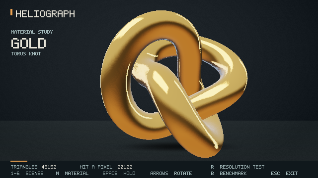

# Heliograph

A freestanding Rust 3D renderer and interactive material lab for **native PCP OS 0.3.1**. Rotate a gold, jade or titanium knot, then put 24 copies on screen and change their mesh density. The same renderer drives every view.



## Run

Run the native Store launcher with the guest name **heliograph**, then press Enter at the PCP OS menu. [Launcher and prerequisites](../../native/README.md) · [Native ELF](dist/heliograph.elf)

| Key | Action |
| --- | --- |
| 1 / 5 | Inspect a single 6,144- or 49,152-triangle mesh |
| 2 / 3 / 4 | Gallery with low, medium or full mesh detail |
| 6 | Same gallery with detail selected from projected geometric error |
| M / Space / left or right | Change material, hold rotation, or rotate manually |
| B | Run the geometry benchmark and write counters to the serial port |
| R | Render the same high-detail object at successive native resolutions and return to the lab |
| Esc | Return to the OS menu. P there powers off. |

## Renderer

The `no_std` library accepts caller-owned color and depth slices, packed vertices and u16 triangle indices, a model transform, and a material capture. Mesh validation checks index ranges, packed lengths and the conservative bounding sphere. Instances share the same mesh. There is one transform per indexed vertex per submitted instance, whole-instance frustum culling, near-plane polygon clipping, triangle back-face rejection, 1/16-pixel edge functions with top-left fill, and interpolated reciprocal depth. Measurements distinguish source and submitted triangles, transformed vertices, triangles covering a pixel, and depth-passing writes.

Lighting uses three original 128×128 view-space material captures baked in Rust from a studio environment with soft panels, a sky gradient and a floor reflection. Vertex normals give the lookup coordinates. The result has specular highlights at modest runtime cost. This prototype has fixed studio lighting, nearest material lookup and screen-linear normal coordinates. Highlights can band or sparkle. It has no scene-dependent reflections, texture UV pipeline, cast shadow maps, skeletal animation or GPU backend. The studio contact shadow is a soft ellipse.

The authoring program builds an indexed torus knot at three densities. It compares each dense reference vertex to the corresponding point on each coarser surface. The maximum sampled displacements are 48, 9 and 0 model units. The detail selector projects that error using instance size, distance and focal length. The gallery's 2.58-pixel selection budget is a prototype setting. Normal and highlight errors can exceed the positional difference. Six poses have an independent image comparison in the test log.

The Rust engine directory supplied for this task includes Bevy and other engines. PCP OS exposes a mapped CPU framebuffer in the tested guest. Heliograph uses that interface directly. For method comparisons, see Giesen's edge-function rasterizer and the meshoptimizer author's discussion of vertex reuse, culling and level-of-detail error. [Rust engine directory](https://arewegameyet.rs/ecosystem/engines/) · [Triangle rasterization](https://fgiesen.wordpress.com/2013/02/10/optimizing-the-basic-rasterizer/) · [Vertex reuse and clusters](https://zeux.io/2023/01/16/meshlet-size-tradeoffs/) · [meshoptimizer LOD guidance](https://github.com/zeux/meshoptimizer#simplification)

## Build and verify

The guest, asset baker, interactive lab, renderer checks and desktop launcher are Rust. Cargo requires no third-party crates. The tested compiler is Rust 1.91.1. The build script generates the mesh and material data on the host before linking it into the guest.

```sh
rustup target add x86_64-unknown-none
cargo test --release --locked --lib -- --nocapture
cargo build --release --locked --target x86_64-unknown-none --bin heliograph
cp target/x86_64-unknown-none/release/heliograph dist/heliograph.elf

```

Use the Store launcher from the repository root. Press B or R with serial redirected to a file to reproduce guest counters. A two-byte frame marker is sent after each page flip during measurement. Each batch emits its detailed counters after its last frame. [Measured results](evidence/TESTING.md) · [PCP OS kernel provenance](https://github.com/KirtusJ/pcp-os/tree/21ef0955eb8828739c1b95bf85f3d880cdaf4eb6/PCP_OS_Rust/crates/pcpos-kernel) · [Kernel notice](../../../PCP_OS_Rust/NOTICE.md)
