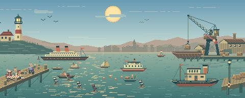

# Bellweather Harbor · Standing Order Thirteen

You have one rowboat, an empty till, and a brass bell. Ring for a one-coin tip and send the boat out. Two seconds later it brings home eight more coins. What happens to the waterfront after that is up to you.

## Play in a browser

Open `dist/Bellweather_Harbor.html` in a desktop or mobile browser with JavaScript and WebAssembly enabled. The game, art and sound are all inside the file. Turn sound on or off in the header.

Buy another unit to increase a business’s payout. Open a berth to add a new business to the harbor scene. Each business has a departure button. Hiring a captain keeps departures running automatically, including up to 12 hours of earnings while you’re away. The income figure in the header shows the average coins per second from captains. Boats pay into the till when they finish a trip.

| Business | First trip | Base trip time | Hire a captain |
| --- | ---: | ---: | ---: |
| Rowboat | 8 coins | 2 seconds | 96 coins |
| Crab Pots | 56 coins | 6 seconds | 750 coins |
| Ferry | 540 coins | 14 seconds | 9,000 coins |
| Dry Dock | 6,400 coins | 26 seconds | 90,000 coins |
| Ocean Liner | 57,600 coins | 45 seconds | 900,000 coins |

At 10, 25, 50, 100, 150 and 200 units, a business doubles its payout. Trips also take half as long at 25, 100 and 200 units. The ledger offers single units, bundles of ten or the largest affordable purchase.

**Harbor mail.** Open the stamp album and choose a berth. Catch the envelope in the gold strip to collect an illustrated postmark and a letter. You can time the catch or use the left and right controls to guide it by hand. The album spans all your charters.

**Charters.** The first offer comes at 500,000 qualifying coins. Fares and tips count in full. Exchange receipts first recover outstanding raw-material purchases and processing fees, then the excess qualifies. Selling purchased crates straight back cannot manufacture charter progress. You may keep growing the port. When you sign, you return to the starting rowboat and receive a permanent 25% business payout bonus per charter. Two charters in a single offer take two million qualifying coins. Three take 4.5 million.

**Saves.** The browser saves in local storage when available. Open the logbook to export a `bellweather.sav` file or to import one on another device. Keep an export before moving the HTML to a different folder or clearing browser data. The native edition uses the same binary ledger.

## A day on the quay

A harbor day takes six minutes. Four watches of three tides each carry the town from dawn at 06:00 through daylight, dusk and night. The sky and the water follow the same clock as the exchange. Sea mist, rain and wind move through on a five-day weather pattern. On the browser's Sound setting you can hear the oars, gulls or foghorn between actions.

Nell Reed tends the lower light, Ada Pike feeds the late shift, and Kit Sayer meets the mail packet. One of them visits the public quay every tide. In the browser, select the visitor in the waterfront scene or choose **On the quay**. On PCP OS, press **Q**. Ring the ordinary harbor bell and listen for an answer from whoever was on duty when you rang. The caption works with sound off.

Ask about work to see the exact cargo and payment. Favors use crates from your hold. The cashbook records their payments with freight orders, and the cargo account records each delivery. You can fill one request per tide. An unfinished request comes back on that person's next visit, and the first three favors for each person unlock a keepsake you can read again. When you have helped all three, watch the channel at dusk. The neighbors sail paper lanterns every evening after that.

The clock, friendships and keepsakes carry across charters. Time continues when you close the game, under the existing offline limit. Favors wait for you to choose them.

## An envelope under the sugar bowl

Launch the lightship Northstar and complete a favor for each of Nell, Ada and Kit. You can do these in either order. When the last condition is met, an envelope appears on the waterfront. Open it in the browser or press **T** on PCP OS. You can leave the envelope unsigned for as long as you like.

To try this chapter immediately, the [invited harbor](scenarios/Committee_Invitation.sav) has Northstar afloat, all three friends, 19 salt, two crab and three crates of provisions. This harbor was played from the starting rowboat. In the browser, export your own harbor from the **Logbook** before importing the invited harbor in its place.

<details>
<summary>Open the minute book (chapter spoilers)</summary>

Beatrice Brine chairs the Emergency Tea Committee. Vera Doig brings the folding chairs. Maud Spooner takes the minutes. Nobody can explain who brought the fourth saucer.



| Proceeding | What you do | What happens on the quay |
| --- | --- | --- |
| Tea Service | Sign Standing Order Thirteen. File three motions at one salt crate apiece. | The grannies set the table. Vera measures the damp patch in the spare chair. |
| Quorum | File three further motions at one provisions crate apiece. The cannery can make them from salt and crab. | The chairs move offshore. The minutes secretary has to turn the register sideways for the guest to finish signing. |
| High Tea | Leave the meeting in session. Ring the harbor bell or open the sea’s barter ticket. | Your neighbor answers first. The sea casts its vote on sugar. It offers a different exchange of freight each tide. |
| Adjournment | Adjourn at High Tea when you are ready to end the sitting. | Claim the rest of the tin, thirteen attendance coins, and the fourth teaspoon. The sea takes its chair home. |

While the committee sits, one out of every eight coins from **business fares** goes into the tea tin. Tips, trades and freight orders go straight to the till. You can empty the tin whenever you like. Fares count toward your charter when earned. Collecting the same coins from the tin adds no second charter credit.

The sea offers one barter per tide. Read both cargo amounts before accepting. Market prices still change independently. Spent crates appear under deliveries in the cargo account, and the freight dredged up by the sea appears under landings. Chartering preserves the sitting and the tin. Time away can bring in fares, but motions and barter need your hand. An adjourned committee leaves its receipts and its souvenir in the minute book.

</details>

## The freight exchange

The first three businesses land cargo alongside their fares. A completed rowboat cycle delivers one salt crate, a crab-pot cycle delivers one crab crate, and a ferry cycle delivers one timber crate. A whole fleet sailing together counts as one cycle. Cargo continues to arrive while you are away until that good’s space fills. Fare income continues when the hold is full.

Choose **Trade freight**. The exchange has four departments.

### Trading floor

One town merchant holds up to 96 crates of each of five goods. The merchant buys all five and sells the three raw materials. Each warehouse starts with 40 crates. The bid is what the merchant pays for one more crate. The ask is what you pay to take one. Selling into a stocked warehouse generally lowers bids. Buying scarce cargo generally raises the next ask. Both prices are whole coins, so small trades can temporarily leave the quote unchanged.

Set the order size to request a particular whole lot, or use Max to fill what your cash, your hold, and the merchant’s warehouse allow. The ticket shows the total across all the individual crate prices. Open **Market depth** to compare what the merchant would pay or charge for 1, 5, 10 and 24 crates. The game checks the displayed terms again before executing a browser trade.

Every 30 seconds the board records the actual closing bid and a new tide begins. Regional supply and demand move the merchant’s stock toward a seasonal target. On scheduled tides an outside cannery or chandler can buy its recipe and return a finished crate, provided its expected margin covers materials, the processing fee and its required return. The trading floor shows its forecast. The next-tide estimate assumes no intervening trades. Your standing instruction may also move the market when it executes.

Signing a posted freight order sets aside the requested stock immediately and locks the stated payment for the next tide. At the opening, three salt crates sell for 18 coins at spot or earn 42 coins from Light Station Stores if you reserve the lot before the first tide ends.

### Processing works

| Workshop | Opening cost | Paid for each batch | Output | Time |
| --- | ---: | --- | --- | ---: |
| Cannery | 420 coins | 1 salt, 2 crab, 8 coins | 1 provisions crate | 8 s |
| Chandler’s Shop | 1,800 coins | 1 salt, 2 timber, 14 coins | 1 fittings crate | 14 s |

The two buildings operate independently. **Repeat** starts another batch when the inputs, cash and output space are available. It can wait for a managed boat to land its next crate. If both workshops qualify at the same instant and only one can use the last salt, the cannery has first call. Each finished crate goes to your hold until sold. The repeat setting never buys supplies on your behalf.

Read **Batch valuation** before committing. One calculation values raw inputs at the proceeds you could get from selling them now. The other prices a fresh recipe at the current asks. Both deduct the processing fee. The selling price may change while the crew works.

### Broker

Post a standing sale for any raw or finished good. Set the total number of crates and the minimum price for **each** crate. You may post before the cargo arrives. The broker checks at the next twelve tide changes and can deliver in parts. Each crate must clear your floor, even when a larger sale would push down the bid. Cargo is available for ordinary trades, processing and shipbuilding right up to execution.

The ticket shows how much was filled and how much cash came in. It closes when filled, cancelled, or after the twelfth clearing. Only one instruction may run at a time. It can settle while the harbor is closed.

### Accounts

The cashbook posts cargo sales, settled freight orders, raw purchases, processing fees and workshop openings. These are the exchange’s cash flows. Buying a building is cash paid. An unsold finished crate is inventory. The warehouse table totals current cash plus the proceeds the merchant can actually pay for the saleable part of each holding. Ships, workshops, reserved freight and unfinished batches are outside that valuation.

Select a commodity in the cargo account to follow its opening inventory, landings, purchases, production, sales, usage and consignments to its closing balance. Older saves import their existing cargo as opening inventory and begin the new cash accounts at zero.

The starting hold fits 24 crates per good. Expansion costs 1,800 coins for 48, then 14,000 for 96. Signing a charter restarts the market, works, trading accounts and outstanding orders. The mail album, shipyard register and paid construction carry over. Earlier public saves import into this edition, including both lengths of BWH5 and the BWH6 mystery journal. Existing harbors meet the neighbors at their current tide.

## An odd receipt

Once your first cargo lands, a slip appears beside the dock notes. Choose **An odd receipt** to open *The Second Manifest*. In an established harbor, look for it as soon as play resumes. Cargo, trips and market tides continue while you read.

Each of the three files asks a question you can answer by matching two records. Inspect a document to read it, pin it, then file your pair. If the pair falls short, read the desk's hint and change the pins. You can revisit filed documents, their sources and the finding throughout the game. After the third finding you choose what occupies the spare room beside the harbor crane. The desk shows the permanent benefit before you sign. The room, case progress and your decision survive a new charter.

After signing, **Circuit Eight** stays open in the casebook. The wire sends two groups of three pulses. Match both groups to one cargo station in the directory. A correct reply brings a one-crate bid for the present tide and estimates for the next three. Town deliveries and competing workshops are included. Your own trades and standing orders can change the result. A full warehouse has no bid. The transmission changes every 30 seconds and guessing costs nothing.

## The shipyard

Visit the slipway to commission three named vessels in order. Open any plan to inspect its requisition. Cash and cargo are paid when you lay the keel. You can keep trading and running businesses while the yard works. Closing the game or signing a charter preserves the ship on the ways. A launch permanently increases the payout of every business.

| Vessel | Requisition | Fitting time | Added to business payouts |
| --- | --- | ---: | ---: |
| Pilgrim, pilot cutter | 24 coins and 4 salt crates | 12 s | 15% |
| Juniper, packet boat | 300 coins, 6 salt and 4 crab crates | 25 s | 20% |
| Northstar, lightship | 3,600 coins, 12 salt, 8 crab and 4 timber crates | 45 s | 25% |

Vessels appear in the main harbor after launch. Pilgrim carries an ochre sail, Juniper crosses the lower channel, and Northstar keeps a light at its mooring. The shipyard register lets you revisit each commissioned vessel. In the browser, **Save ship’s certificate** downloads a printable illustrated PNG.

The three vessels together add 60 percentage points to business payouts, on top of charter bonuses. The game rounds each business payout down to whole coins. Bell tips, freight prices, and order payments retain their own rates.

## Play on PCP OS

The archive includes the x86-64 static PIE guest at `dist/bellweather.elf`. To use an existing PCP OS 0.3.1 kernel, pass the game as its Multiboot module and select the game in the launcher.

```sh
qemu-system-x86_64 -cpu max -m 256M -vga std \
  -kernel /path/to/pcpos-kernel.elf32 -initrd dist/bellweather.elf
```

| Key | Action |
| --- | --- |
| R | Ring the bell |
| 1–5, Left or Right | Select a business |
| Space or Enter | Dispatch a business |
| B | Buy units |
| X | Cycle between one, ten and maximum |
| M | Hire a captain |
| P, then Space | Open harbor mail and catch the bag |
| Q | Visit the quay |
| 1–3 / V on the quay | Select a neighbor / visit the person on duty |
| Enter / D on the quay | Deliver the displayed request / decline it |
| L on the quay | Open the selected neighbor’s keepsakes |
| T when the envelope appears | Open the envelope or return to the meeting |
| S / Enter / C / M in the meeting | Sign the order / file the shown motion / collect the tin / read the minutes |
| B during High Tea | Read the sea’s offer. Enter trades the listed cargo. R fetches a fresh slip if the tide has changed. |
| A during High Tea, then Enter | Adjourn the sitting and collect the final payment |
| J | Examine the odd receipt, then reopen the casebook |
| 1–4 / Space / Enter in a case | Read a lead / tag it / file the pair |
| H / N in a case | Read the hint / continue after a finding |
| Left or Right in a case | Revisit available files |
| E in the signed conclusion | Listen at Circuit Eight |
| Space / 1–5 at the wire | Replay the signal / identify the transmitting cargo station |
| Y | Open the shipyard |
| 1–3 or arrows in the shipyard | Inspect a ship plan |
| Enter or B in the shipyard | Pay the requisition and lay the keel |
| F | Open the freight exchange |
| 1–5 or arrows in the exchange | Select a commodity |
| B / X in the exchange | Buy one / maximum raw crates |
| H / L in the exchange | Inspect prices / open standing sale instructions |
| Arrows / X on the standing sale | Adjust quantity and price floor / change adjustment step |
| Enter / C on the standing sale | Place / cancel the instruction |
| S / A in the exchange | Sell one crate / all of that good |
| R / U in the exchange | Reserve the posted order / expand the hold |
| W | Open processing works |
| 1 or 2 at the works | Select the cannery or chandler |
| O / Enter / T at the works | Open building / start one batch / toggle repeat |
| S / A at the works | Sell one / maximum finished crates |
| L at the works, then C | View the cashbook, then toggle physical cargo accounts |
| C, then Enter | Review and sign a charter |
| Escape | Close a panel, or save and return to the launcher |

The guest uses framebuffer, keyboard and file-store access. AC’97 audio is optional. The PCP OS 0.3.1 session store retains the ledger across launches until the guest powers off.

## Build from source

The Rust library in `game/` contains the integer economy, ledger format, and harbor renderer. The browser adapter in `web/` shares these with the native adapter in `guest/`. The browser draws the ledger, stamps, and control panel with HTML, JavaScript, CSS and Canvas. The workspace has no third-party Rust game dependencies.

A recent stable Rust toolchain (1.84 or newer), Python 3 and Bash build the browser edition.

```sh
rustup target add wasm32v1-none
cargo test --locked -p bellweather
bash tools/build_web.sh
```

The native guest additionally requires an x86-64 musl compiler driver and GNU binutils.

```sh
rustup target add x86_64-unknown-linux-musl
bash tools/build_guest.sh
```

Set `MUSL_CC` and `STRIP` to your toolchain executables when cross compiling. Each build script accepts an optional output filepath.
