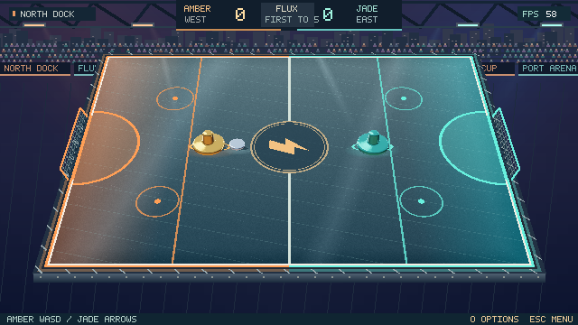

# Flux Rink

**Native PCP OS game · two-player 3D air hockey · 0.1.0 prototype**

Score five goals to win. Each paddle stays in its own half. In a local duel Amber uses WASD and Jade uses the arrows. Linked play uses WASD on each machine. The host can press Enter after the fifth goal for a rematch.

The 640×360 arena uses Heliograph's indexed triangle renderer for the mallets and puck. The camera projects a cached ice surface, raked stands, netted goals, brass and cyan side lighting, and a centre-ice crest. The playing pieces have studio material highlights and contact shadows. The arena lighting and floor reflections are baked. There is one arena and no audio in this prototype. [Engine](../../engines/heliograph/) · [Performance and captures](evidence/TESTING.md)

## Settings

Press **O** before or during a match. Up and Down select a row, Left and Right change it, and **Apply and save** commits it. Escape cancels edits. Defaults can be restored before applying. Settings include the FPS counter, a 30 or 60 FPS cap or uncapped rendering, ice detail, and standard or wide framing. The keys for editing and backing out stay visible. A local match pauses in settings. In a linked match the host simulation continues and the player in the menu sends neutral input. The stock PCP OS file store keeps applied settings across guest relaunches within a single boot.

The design uses explicit keyboard focus and a consistent back action, following Xbox's navigation guidance. The fixed arena camera and adjustable framing follow its guidance on visual motion. The on-screen FPS counter uses a half-second window on the guest monotonic clock. Independent host-side presentation timings are in the test report. [XAG 112 on navigation](https://learn.microsoft.com/en-us/xbox/accessibility/xbox-accessibility-guidelines/112) · [XAG 117 on visual motion](https://learn.microsoft.com/en-us/xbox/accessibility/xbox-accessibility-guidelines/117)

## Linked play

Local play runs on the stock kernel. The optional `game-link` kernel exposes a nonblocking COM2 device to the guest whose ELF digest was granted at boot. Two QEMU processes connect their virtual cables over a loopback TCP socket. Start the host VM first and select **Host cable duel**. Start the second VM and choose **Join cable duel**. [Native launcher commands](../../native/README.md#linked-flux-rink)

The host owns puck physics, collisions, scores and the 60 Hz simulation. The peer sends held direction bits at up to 20 Hz. The host sends absolute positions and scores at the same rate. The receiver checks frame type, checksum, value ranges and wrapping sequence numbers. The compact sixteen-byte snapshot fits one legacy UART FIFO. It quantizes positions to four world units and interpolates successive snapshots over three simulation ticks. Late input expires and a lost peer returns the display to waiting. The checksum detects transmission errors. This private loopback prototype omits authentication, Internet matchmaking, latency compensation and client-side prediction. The QEMU cable operates independently of the kernel's Ethernet probes. [Authoritative simulation](https://www.gabrielgambetta.com/client-server-game-architecture.html) · [Snapshot interpolation](https://gafferongames.com/post/snapshot_interpolation/) · [Fixed simulation steps](https://gafferongames.com/post/fix_your_timestep/)

Build with the [native instructions](../../native/README.md) or use the [packaged ELF](dist/fluxrink.elf). Run `cargo test --locked --release --lib` to exercise movement, goals, settings, corruption, wraparound, and snapshot validation.
