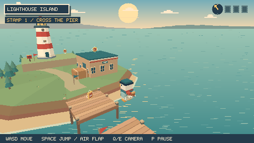

# Gullpost Express 64
## Lighthouse Island · v0.1.1



Collect three postmarks and deliver the keeper's letter. Start at the broken pier, climb onto the boathouse roof and look behind the lighthouse. The gold compass points to your next stop. You can collect the stamps in any order.

**Play on native PCP OS.** From the repository root, run `sh store/play-native.sh`. Select **gull64.elf** and press **Enter**. At the cover, **Space** starts free play and **F2** starts a guided delivery using the same movement and collision rules. [Native guest](dist/gull64.elf) · [Store launcher setup](../../README.md#play-on-pcp-os) · [Watch a delivery](evidence/courier-run.gif)

| Control | Action |
| --- | --- |
| WASD or arrow keys | Move relative to the camera |
| Q / E | Orbit left / right |
| Space or Enter | Jump. Hold for height. Release and press again for one midair flap. |
| P | Pause or resume |
| R | Retry from the pier or shore checkpoint with collected stamps |
| Escape | Return to the PCP OS menu |

### 3D test record

The v0.1.1 audit passed 16 rendering and gameplay checks. It includes a before-and-after view of the terrace, independent depth and edge-coverage checks, a 192-view camera sweep, and native playthroughs. Three guided deliveries ran at 39.9 FPS. Thin silhouettes still show stair-stepping at 512×288. Free-play frames exceeded the 25 ms budget in both the original audit and the Store replay. The original free-play run also logged nine audio underruns. [Full report, captures and raw logs](evidence/render-0.1.1/REPORT.md)

### Build and test

The renderer, camera, physics, sound and native device interface are Rust. The game uses a fixed-step simulation and targets 40 FPS. To build the freestanding x86-64 guest, run these commands from this game directory with Rust 1.91.1 or compatible.

```sh
rustup target add x86_64-unknown-none
cargo build --locked --release --target x86_64-unknown-none --bin gull64
cp target/x86_64-unknown-none/release/gull64 dist/gull64.elf
```

To check the renderer and gameplay on the host, or exercise the native ELF through the Store menu, use the following commands. The QEMU driver takes a fresh directory for its serial log and captures. It uses the Store launcher's build and kernel settings, and expects `sh` and `qemu-system-x86_64` on PATH.

```sh
rustc --edition 2021 -O --test tools/render-tests.rs -o render-tests
./render-tests --nocapture --test-threads=1
rustc --edition 2021 -O tools/qemu-check.rs -o qemu-check
./qemu-check ./new-render-audit
```
