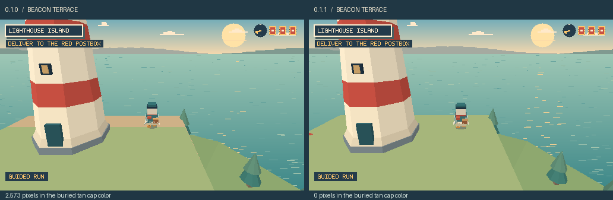

# Lighthouse Island rendering audit · 0.1.1

The clearest in-game defect was the strip of tan ground showing through the lighthouse terrace. In these native captures, the old view contains 2,573 pixels of the buried cap's color and the revised view contains zero. Both were taken at the third-stamp event. Keyboard and screenshot polling can sample slightly different ticks. The separate host comparison below samples exactly the same simulation ticks on each build.



## Scope and build identity

- Game guest 0.1.0 SHA-256 `0916ea3b5f5dff058907c8f2683d0d1132c81ce51cf4f1539c5286330158987e`.
- Game guest 0.1.1 SHA-256 `06cbdbbfbf18a320be73a81354006195bdff200cfd1e62a2dfe6c7a6fe4adfaf`, 86,664 bytes. The native launcher logged this digest on both admissions.
- PCP OS 0.3.1, QEMU 11.1.0 with TCG, 256 MiB, std VGA, AC'97, headless display, 512×288 color buffer. Kernel image measurement `773ac9cba84ba404264177c2781d3f626eaa04df4061cddb823a49e92430a3a1`.
- The same Rust host harness was compiled against each renderer. The QEMU driver separately exercised the user-mode ELF, kernel framebuffer, input path and launcher. [Host checks](../../tools/render-tests.rs) · [QEMU driver](../../tools/qemu-check.rs)

## Defects reproduced and retested

| Check and pass condition | 0.1.0 | 0.1.1 |
| --- | ---: | ---: |
| The nearer of two planes one world unit apart covers every interior sample. An independent ray/plane oracle checks 807,608 samples at four camera tilts and three elevations. | 1,067 wrong | 0 wrong |
| Reversing a near-clipped panel and splitting it along its other diagonal preserves coverage at 21 offsets. | 7,419 samples differed | 0 differed |
| A quadrilateral at half-pixel positions agrees with an independent top-left half-space oracle over all 147,456 pixels. | 254 mismatches | 0 mismatches |
| The same heading, represented as −1 and 255, gives identical atmospheric pixels. | 11,959 differed | 0 differed |
| Heading 255 advancing to 0 moves the frozen backdrop by five pixels across the common viewport. | 11,867 mismatches | 0 mismatches |
| An upward ray under a solid box sees the shaded underside. | Saw the back wall `#a32b00` | Saw the bottom `#902600` |
| A buried tan cap contributes zero pixels to 25 equally spaced gameplay views. | 32,545 total, 10,831 worst frame | 0 total |

Camera coordinates and screen projection now retain fractional precision through clipping. Shared edges use the same near-plane intersection in either direction. Scanlines evaluate their edges at pixel centers from the original endpoints. The terrace has one grass surface, and closed solids include their undersides. Clouds, waves and distant hills now share the same full-turn period. The sky stays continuous across north in the frozen-time test.

An intermediate version passed the plane-depth check but still showed 1,507 tan pixels across the 25 route views. Replacing the layered terrace caps removed those. A separate 49-pixel background mismatch persisted at the yaw boundary until the silhouette stopped snapping to two-pixel screen columns.

## What held up

- **Occlusion and clipping.** Ordinary near/far objects gave identical colors in either draw order on both builds. A face entirely behind the near plane wrote zero pixels. Reversing draw order for the two triangles of the half-pixel fixture also preserved the result on both builds.
- **Coverage and repeatability.** All 147,456 samples in a straight-down terrace view were grass on both versions. Both renderers completed 192 camera views around the boathouse, beacon and pier. For 24 of those views, starting with contaminated color and depth buffers produced the same final image as the first draw.
- **Gameplay.** All six physics checks passed before and after the changes. QEMU free-play inputs exercised falling into the water, respawn, jumping, flapping, camera orbit, pause/resume, retry and return to the menu. The relaunched guest delivered the letter three times and collected all three stamps on every route.
- **Guest cleanup.** Both QEMU guest exits returned every allocated game frame, with 59,887 frames free before and after each invocation. The kernel verified its final register and completed a normal shutdown. A separate launcher run also reached delivery and produced the updated [animated preview](../courier-run.gif).

The final host result was **16 passed**, including the six gameplay tests. The original build passed nine checks and failed seven. [Original test output](host-before.txt) · [Retest output](host-after.txt) · [Native serial log](qemu-serial.txt) · [Preview session log](preview-serial.txt)

## Store publication check

A clean Store checkout rebuilt the v0.1.1 guest byte-for-byte and passed all 16 host checks. The shared launcher loaded Night Post, Bellweather Harbor and Gullpost Express 64. The test selected gull64.elf, exercised free play, returned to the menu, launched it again and delivered three letters. Both guest invocations exited with status 0. The kernel verified its final register. [Shared-launcher serial log](store-launch-serial.txt)

In this Store replay, 20 of 110 measured free-play frames and 2 of 936 guided frames exceeded 25 ms. The slowest frame took 39.99 ms. The simulation dropped zero ticks. The timings below come from the earlier rendering audit on the same guest binary.

## Native timing

The guest clock measures drawing, framebuffer copy and page flip at approximately 1 ms resolution. FPS below is the kernel's measured presentation cadence. Render timings exclude sleeping and game logic.

| Guided delivery | Frames | Mean draw and present | 95th percentile bucket | Maximum | Above 25 ms |
| --- | ---: | ---: | ---: | ---: | ---: |
| 1 | 312 | 11.21 ms | 18–19 ms | 23.00 ms | 0 |
| 2 | 312 | 6.91 ms | 8–9 ms | 15.00 ms | 0 |
| 3 | 312 | 7.78 ms | 12–13 ms | 19.00 ms | 0 |

The guided runs averaged **8.63 ms** over 936 frames and the kernel counted **39.9 FPS** across that guest invocation. The original three-route measurement averaged 8.79 ms at 39.9 FPS. These were separate runs on a shared host. The difference is too small to infer a speed improvement.

The free-play invocation averaged **39.7 FPS**. Its two measured gameplay segments contained 135 frames, three above the 25 ms target and a maximum of 26.00 ms. Neither free play nor the guided runs dropped simulation ticks. The kernel also logged nine sound-queue underruns during free play, outside the graphics measurements. [Original benchmark](../RESULTS-0.1.0.md)

## Reproduce

Run the following from the game directory. The renderer harness links the guest source directly and includes the physics tests. The Store edition of the QEMU driver opens the shared native menu, selects gull64.elf and exercises the same free-play and guided inputs. Run it with sh and qemu-system-x86_64 on PATH.

```sh
rustc --edition 2021 -O --test tools/render-tests.rs -o render-tests
./render-tests --test-threads=1 --nocapture
rustc --edition 2021 -O tools/qemu-check.rs -o qemu-check
./qemu-check ./new-render-audit
```

## Remaining artifacts and test limits

- **Visible edges.** Fine silhouettes still show stair-stepping at 512×288, including the sloping edges around the island. See the [free-play framebuffer](../free-play.png) at native resolution.
- **Free-play timing and sound.** Three of 135 measured free-play frames exceeded 25 ms, and the kernel recorded nine audio queue underruns in that guest invocation. Both are retained in the timing record above.
- **Coverage.** The camera sweep covered 192 sampled poses. Physical display tearing, monitor latency and GPU scaling require a display-side test. The headless QEMU run measures the guest framebuffer.
