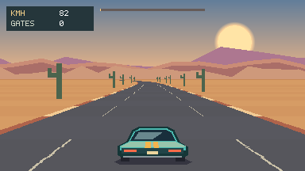

# Sunspur Rally

**Native PCP OS game · single-player arcade time trial · 0.1.0 alpha**

Drive Cinder Pass through five checkpoint gates. Each clean gate takes one second off the finish time. The shoulder slows the coupe. The F2 driver steers and accelerates through the same race rules.

| Key | Action |
| --- | --- |
| Enter | Start or replay |
| Up / W, Down / S | Accelerate, brake |
| Left / A, Right / D | Steer |
| F2 / R / Esc | Demonstration, restart under manual control, return to PCP OS |

The Rust guest renders the canyon, track and coupe at 384×216. The road uses perspective scanlines. Run `cargo test --release --locked --lib` here for the full-route and off-road checks. In QEMU, keyboard driving, a complete demonstration and verified shutdown were exercised. [Native launch and build](../../native/README.md) · [Store ELF](dist/sunspur.elf)
